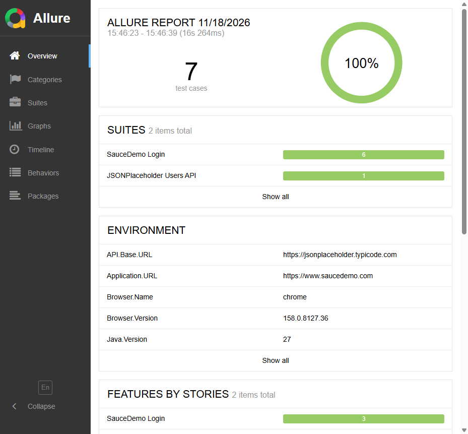
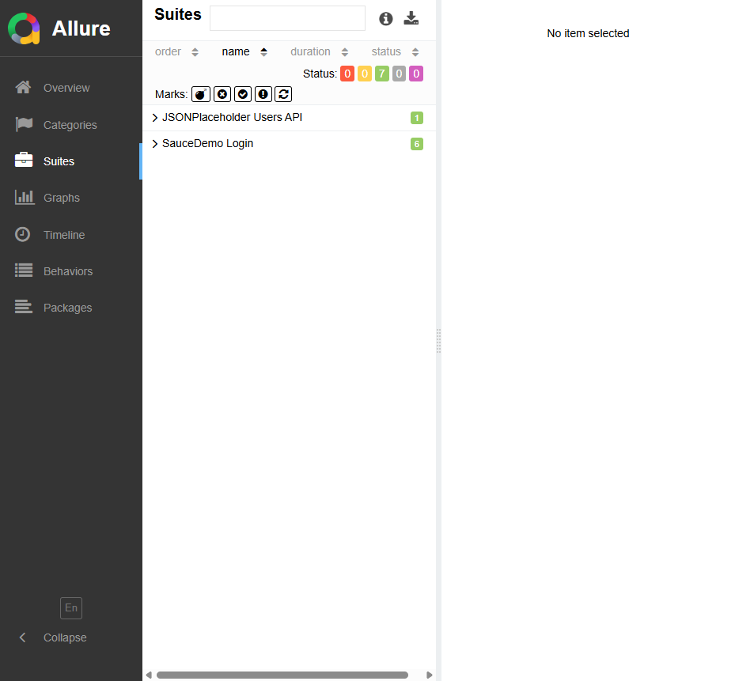
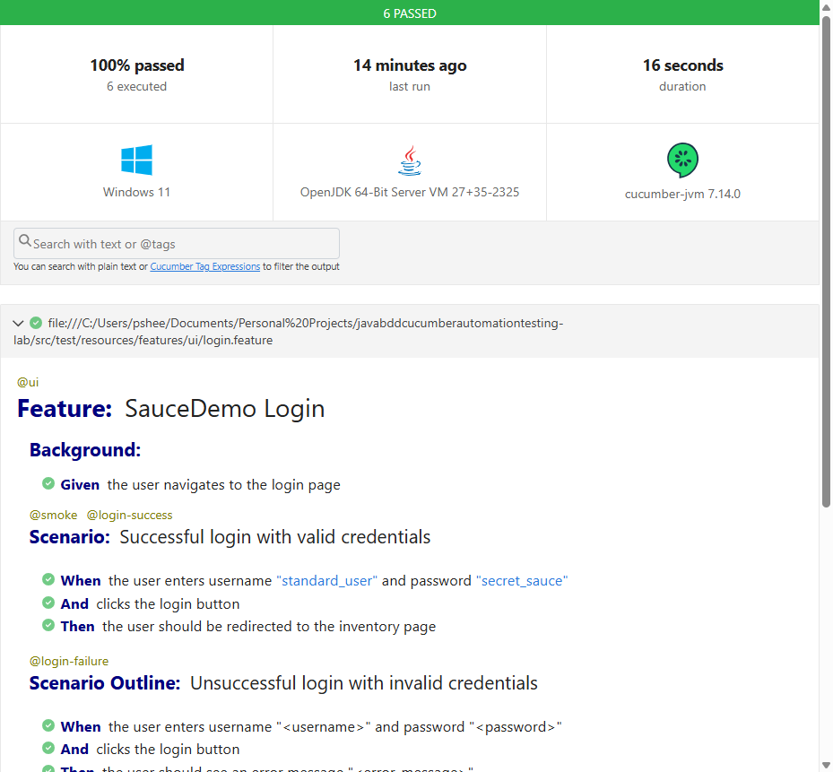

# Java BDD Cucumber Automation Testing Framework

A production-ready BDD test automation framework covering UI and API testing with parallel cross-browser execution, Allure reporting, Docker support, and GitHub Actions CI.

## Tech Stack

| | |
|---|---|
| Language | Java 11 |
| Build | Maven 3.9 |
| BDD | Cucumber 7 + JUnit 4 |
| UI | Selenium 4.15 (Selenium Manager) |
| API | REST Assured 5.3 |
| Reports | Allure 2.24 + Cucumber HTML |
| CI | GitHub Actions |
| Containers | Docker + Docker Compose |

## Prerequisites

| Tool | Version |
|---|---|
| Java JDK | 11+ |
| Maven | 3.9+ |
| Chrome | Any (Selenium Manager auto-matches driver) |
| Firefox | Any (optional, for cross-browser) |
| Docker | 24+ (optional) |

## Project Structure

```
├── src/
│   ├── main/java/com/automation/
│   │   ├── config/ConfigReader.java       # config.properties loader (system props override)
│   │   ├── pages/
│   │   │   ├── BasePage.java              # POM base — driver/wait helpers
│   │   │   └── LoginPage.java             # SauceDemo login page object
│   │   └── utils/DriverManager.java       # ThreadLocal WebDriver factory
│   └── test/
│       ├── java/com/automation/
│       │   ├── hooks/Hooks.java            # Allure setup, browser lifecycle, screenshots
│       │   ├── runners/
│       │   │   ├── ChromeTests.java        # Cucumber JUnit4 runner — Chrome
│       │   │   ├── FirefoxTests.java       # Cucumber JUnit4 runner — Firefox
│       │   │   └── APITests.java           # Cucumber JUnit4 runner — API (no browser)
│       │   └── stepdefinitions/
│       │       ├── LoginSteps.java
│       │       └── UserAPISteps.java
│       └── resources/
│           ├── features/
│           │   ├── ui/login.feature        # 6 login scenarios
│           │   └── api/users.feature       # JSONPlaceholder /users/2 validation
│           ├── config.properties
│           ├── allure.properties
│           └── cucumber.properties         # IDE step resolution
├── allure-history/                         # Persistent TREND data — commit this folder
├── generate-report.bat                     # Windows: generate report + open
├── Dockerfile
├── docker-compose.yml
└── .github/workflows/ci.yml
```

## Running Tests

### Local — Maven (recommended)

```bash
# All tests: Chrome + Firefox + API in 3 parallel JVM forks
mvn clean test

# Chrome + API only
mvn clean test -Dtest=ChromeTests,APITests

# Firefox only
mvn clean test -Dtest=FirefoxTests

# Headless (CI-compatible)
mvn clean test -Dheadless=true
```

### Local — IntelliJ IDEA

Use the pre-configured run configs in the **Run** toolbar dropdown:

| Config | Runs |
|---|---|
| `ChromeTests` | Chrome UI scenarios + Allure |
| `FirefoxTests` | Firefox UI scenarios + Allure |
| `APITests` | REST API scenarios |

> Requires: **File → Settings → Build Tools → Maven → Maven home path** set to your Maven installation.

### Docker

```bash
# All tests (Chrome + Firefox + API)
docker compose up --build

# Chrome only
docker compose --profile chrome up --build

# Firefox only
docker compose --profile firefox up --build
```

Results are written to `./target/` and `./allure-history/` on your host via volume mounts.

### Configuration Overrides

All properties in `config.properties` can be overridden via `-D` system property:

| Property | Default | Example override |
|---|---|---|
| `browser` | `chrome` | `-Dbrowser=firefox` |
| `headless` | `false` | `-Dheadless=true` |
| `base.url` | `https://www.saucedemo.com` | `-Dbase.url=https://staging.example.com` |
| `implicit.wait` | `10` | `-Dimplicit.wait=5` |

## Reports

### Allure Report

```bash
# After mvn test completes:
.\generate-report.bat        # Windows — generates report, saves history, opens browser
```

The report opens at `target/allure-report/index.html` served via local HTTP (required — Allure uses JavaScript fetch, which browsers block from `file://`).

**Overview — 100% pass rate with Environment details (Browser, OS, Java version)**



**Suites view — test results grouped by feature**



**TREND widget** populates from the second run onwards. History is persisted in `allure-history/` (committed to the repo).

**Browser grouping** in Suites view (when both Chrome and Firefox run):
```
Chrome → SauceDemo Login → Scenario
Firefox → SauceDemo Login → Scenario
```

### Cucumber Native HTML Report

Generated automatically after `mvn test` at:
- `target/cucumber-reports/chrome/cucumber-report.html`
- `target/cucumber-reports/firefox/cucumber-report.html`
- `target/cucumber-reports/api/cucumber-report.html`

**Chrome — 6 scenarios, 100% passed, with feature/step breakdown**



## CI — GitHub Actions

Workflow file: `.github/workflows/ci.yml`

```
Push / PR to main or develop
         │
         ├── Chrome + API Tests (ubuntu-latest, headless)
         │
         └── Firefox Tests (ubuntu-latest, headless)
                  │
                  └── Allure Report (merge results → GitHub Pages)
```

The Allure report is published to the `gh-pages` branch on every push to `main`. Enable **GitHub Pages** in your repo settings (source: `gh-pages` branch) to view it at `https://<user>.github.io/<repo>/`.

## Test Coverage

### UI — SauceDemo (https://www.saucedemo.com)

| Tag | Scenario |
|---|---|
| `@smoke @login-success` | Successful login with valid credentials |
| `@login-failure` | Invalid username / invalid password / empty username / empty password |
| `@login-locked` | Locked-out user |

### API — JSONPlaceholder (https://jsonplaceholder.typicode.com/users/2)

| Field | Expected value |
|---|---|
| `name` | Ervin Howell |
| `username` | Antonette |
| `email` | Shanna@melissa.tv |

## Architecture Notes

**Why Selenium Manager instead of WebDriverManager?** WebDriverManager 5.6.3 was released before Chrome 115+ and cannot reliably resolve drivers for newer versions. Selenium Manager (bundled in Selenium 4.6+) is maintained in sync with Chrome's release cycle.

**Why JVM forks for cross-browser parallelism?** The browser is set via `static { System.setProperty("browser", "...") }` which is JVM-global. Using separate JVM forks (`forkCount=3 reuseForks=false`) isolates the property per browser — no thread-safety workarounds needed.

**Why `generate-report.bat` instead of `mvn allure:report`?** `allure-maven 2.12.0` crashes with `ExceptionInInitializerError` on Java 17+. The report IS generated successfully, but Maven reports BUILD FAILURE before the history-save step runs. The bat script calls the downloaded Allure CLI directly, which works on any Java version.
